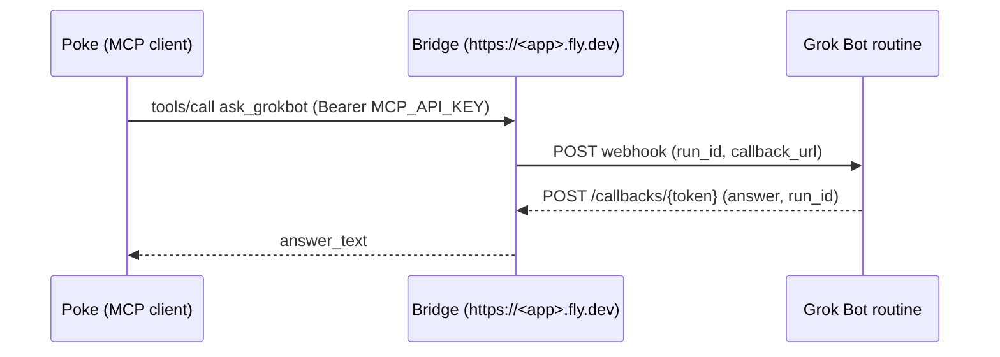

# grokbot-mcp-bridge

English | [日本語](README.ja.md)

**What it does:** lets Poke — or any MCP client — ask a Grok Bot a question and get the answer back as a normal tool result, even though Grok Bot can only reply asynchronously via a webhook callback.

**Who it is for:** anyone who can deploy a small app to Fly.io and has a Grok Bot routine with a Web webhook trigger. No knowledge of MCP internals is needed; the quick start below is copy-paste.

**How:** the bridge holds the Cursor webhook URL/key server-side, so Poke only ever sees the bridge URL and one API key you generate.

## How it flows



## Documentation

| Document | English | 日本語 |
|---|---|---|
| Overview (this file) | [README.md](README.md) | [README.ja.md](README.ja.md) |
| Bridge specification and operations | [SPEC.md](SPEC.md) | [SPEC.ja.md](SPEC.ja.md) |
| Calling Grok Bot from Poke | [poke-invocation.md](poke-invocation.md) | [poke-invocation.ja.md](poke-invocation.ja.md) |

## Quick start (Poke → Grok Bot in four steps)

`<app>` below is `app` in `fly.toml` (defaults to `grokbot-mcp-bridge`).

### 0. Which value goes where

#### Required (3 secrets + 1 URL)

| Value | Where you get it | Where you enter it |
|---|---|---|
| `CURSOR_WEBHOOK_URL` | Grok Bot app → the routine with the **Web webhook** trigger → "POST URL" (`https://api2.cursor.sh/automations/webhook/…`) | Fly secret on the bridge (step 2) |
| `CURSOR_WEBHOOK_API_KEY` | Same screen → "Key" (`crsr_…`). Copy only the key, not the `Authorization: Bearer` header line | Fly secret on the bridge (step 2) |
| `MCP_API_KEY` | Generate yourself (`openssl rand -hex 32`) | Fly secret (step 2) **and** Poke → New Integration → "API Key" (step 3) — same value in both |
| `https://<app>.fly.dev/mcp` | Fixed by the bridge | Poke → New Integration → "Server URL" (step 3) |
| Grok Bot routine instructions | This repo: [poke-invocation.md § 4](poke-invocation.md#4-incoming-webhook-bridge--grok-bot) (ready-to-paste template) | Grok Bot app → the same routine → "Instructions" field |

Routine screen: chat header → info panel → Routines → Web webhook.

#### Optional (skip on first setup)

| Value | Where you get it | Where you enter it |
|---|---|---|
| `INBOUND_WEBHOOK_SECRET` | Generate yourself (optional) | Fly secret (step 2), and the Grok Bot-side push routine if you use `POST /hooks/grokbot` |
| `CALLBACK_ALLOWED_HOSTS` | Comma-separated hostnames the inbound `callback_url` may target (e.g. `callback.example.com`) | Fly secret (step 2), only for push delivery |

Only for push delivery via `POST /hooks/grokbot` (`list_grokbot_events`). Not needed for `ask_grokbot`.

### 1. Prepare the Grok Bot webhook

In the Cursor automation that runs Grok Bot, enable the webhook trigger and copy its URL and `crsr_…` API key. They become `CURSOR_WEBHOOK_URL` / `CURSOR_WEBHOOK_API_KEY` and are stored only on the bridge — Poke never sees them.

The routine's Instructions field must tell Grok Bot to echo `run_id` and POST the answer to `callback_url` — paste the template from [poke-invocation.md § 4](poke-invocation.md#4-incoming-webhook-bridge--grok-bot).

### 2. Deploy the bridge to Fly.io

Log in with `flyctl auth login`, or for non-interactive use create a token at https://fly.io/tokens and export it as `FLY_API_TOKEN` (tokens have an expiry you choose at creation; renew before it lapses).

```bash
export MCP_API_KEY="$(openssl rand -hex 32)"            # keep this value: Poke needs it in step 3
export INBOUND_WEBHOOK_SECRET="$(openssl rand -hex 32)" # optional (push delivery only)
flyctl apps create <app>
flyctl volumes create bridge_data -r <region> -s 1 -a <app> --yes   # SQLite lives on /data
flyctl secrets set -a <app> \
  CURSOR_WEBHOOK_URL="$CURSOR_WEBHOOK_URL" \
  CURSOR_WEBHOOK_API_KEY="$CURSOR_WEBHOOK_API_KEY" \
  MCP_API_KEY="$MCP_API_KEY" \
  INBOUND_WEBHOOK_SECRET="$INBOUND_WEBHOOK_SECRET" \
  ALLOWED_HOSTS=<app>.fly.dev \
  DB_PATH=/data/bridge.db
flyctl deploy --remote-only --ha=false -a <app>
```

- `MCP_API_KEY` and `INBOUND_WEBHOOK_SECRET` are **not** issued by Poke or Cursor; you generate them yourself. `echo "$MCP_API_KEY"` shows it in the same shell — Poke needs the same value in step 3, and Fly does not show secret values again.
- `INBOUND_WEBHOOK_SECRET` is optional. Without it, `POST /hooks/grokbot` returns 503 and `bridge_status` reports `inbound_webhook_secret_configured: false`; `ask_grokbot` still works.
- Push delivery via `POST /hooks/grokbot` also needs `CALLBACK_ALLOWED_HOSTS`. The value is the hostname of the `callback_url` your Grok Bot routine puts in the webhook body (comma-separate multiple hosts; `example.com` also covers `api.example.com`). To see which hosts past events used, call `list_grokbot_events` → `get_grokbot_event(id)` from Poke and check `body.callback_url` / `reply_url` / `response_url`.

  ```bash
  flyctl secrets set -a <app> CALLBACK_ALLOWED_HOSTS=callback.example.com
  ```

  Unset → every inbound `callback_url` is rejected (a well-formed https URL reports `callback_error: "allowed_hosts_not_configured"`; other URLs fail earlier checks). The event itself is still recorded; `ask_grokbot` is unaffected.

### 3. Connect Poke

Add an MCP integration in Poke with:

| Field | Value |
|---|---|
| Name | any label, e.g. `grokbot-mcp-bridge` |
| Server URL | `https://<app>.fly.dev/mcp` (Streamable HTTP). Use `https://<app>.fly.dev/sse` if the client only supports SSE |
| API Key | the value of `MCP_API_KEY` (no `Bearer ` prefix). Poke labels this field optional, but leave it empty and Poke will try OAuth and fail — always set it |

### 4. Verify end to end

1. `GET https://<app>.fly.dev/healthz` → `200 {"ok":true}`
2. From Poke, call `bridge_status` → `webhook_url_configured` and `webhook_api_key_configured` are `true` (`inbound_webhook_secret_configured` is `false` if you skipped the optional secret — that is fine)
3. From Poke, call `ask_grokbot` with `payload={"message": "Introduce yourself briefly."}`, `wait_seconds=60`
   - `answer_status: "answered"` → `answer_text` holds the reply
   - `answer_status: "pending"` → call `wait_for_grokbot_answer(run_id)` (default 60s, max `MAX_WAIT_SECONDS`) or `cancel_run` to stop
   - `answer_status: "cancelled"` / `"expired"` → do not wait; start a new `ask_grokbot` if needed

   Sample result:

   ```json
   {
     "ok": true,
     "run_id": "06eec502-cf7b-468d-8307-8dcf945e1f17",
     "answer_status": "answered",
     "answer_text": "…the reply text…",
     "summary": "Grok Bot answered: …"
   }
   ```

4. `flyctl logs -a <app>` shows `run created` → `callback resolved` → `trigger returning`

For the Grok Bot-side contract (echoing `run_id`, posting to `callback_url`) and troubleshooting, see [poke-invocation.md](poke-invocation.md).

## Endpoints

- `GET /healthz`
- `GET /`
- `POST /mcp` (authenticated MCP)
- `GET /sse` and `POST /messages/` (authenticated MCP)
- `POST /hooks/grokbot` (signed inbound Grok Bot events)
- `POST /callbacks/{token}` (Grok Bot answers)

## MCP tools

- `bridge_status`
- `ask_grokbot`
- `get_grokbot_run`
- `wait_for_grokbot_answer`
- `cancel_run`
- `list_grokbot_runs`
- `list_grokbot_events`
- `get_grokbot_event`

Resources are available at `grokbot://events` and `grokbot://runs`.

## Environment variables

`CURSOR_WEBHOOK_URL`, `CURSOR_WEBHOOK_API_KEY`, `MCP_API_KEY`,
`INBOUND_WEBHOOK_SECRET`, `DB_PATH`, `ALLOWED_HOSTS`, `PUBLIC_BASE_URL`,
`CALLBACK_TTL_SECONDS`, `CALLBACK_ALLOW_HTTP`, `CALLBACK_ALLOWED_HOSTS`,
`RUN_RETENTION_SECONDS`, `EVENT_RETENTION_SECONDS`, `CLEANUP_INTERVAL_SECONDS`,
`RATE_LIMIT_PER_MINUTE`, and `MAX_WAIT_SECONDS`. See [SPEC.md](SPEC.md) §7
for defaults (key names only; do not put secret values in docs or `.env.example`).

## Callback contract

Grok Bot should POST JSON such as:

```json
{"ok": true, "answer": "...", "run_id": "<echoed uuid>"}
```

The `run_id` (or `request_id`) must echo the UUID sent by `ask_grokbot`.
When an inbound webhook has no callback URL, the bridge returns
`「コールバックURLなし」` ("no callback URL") and records the event without
delivering a callback.

## Commands

```bash
uv run --extra dev pytest -q               # tests
uv lock && uv export --no-dev --format requirements-txt --no-emit-project -o requirements.txt   # update pinned deps
flyctl deploy --remote-only --ha=false     # deploy (app / region come from fly.toml)
```

## License

MIT — see [LICENSE](LICENSE).

## Local stdio MCP (desktop AI hosts, without a Fly.io MCP deployment)

The bridge also supports **local MCP over stdio**. It includes the same eight Grok Bot tools as the HTTP MCP server **plus two local-only, nonsecret Keymaster owner-inbox tools** (10 tools total). It starts a **loopback-only** HTTP receiver at `127.0.0.1:PORT` for Grok Bot's asynchronous callbacks; the server's MCP protocol itself uses stdin/stdout. It does not open a public MCP endpoint or require `MCP_API_KEY` for the local stdio connection.

Install the package from this repository in your chosen Python environment, then configure the local MCP-capable host to run the installed `grokbot-mcp-stdio` command:

```shell
python -m pip install -e .
grokbot-mcp-stdio
# Or, from this repository:
python -m app.stdio
# Or from any working directory, without installing the package:
python /absolute/path/to/grokbot-mcp-bridge/scripts/grokbot-mcp-stdio.py
```

Provide `CURSOR_WEBHOOK_URL` and `CURSOR_WEBHOOK_API_KEY` to the **local process environment** using the owner's secret management, not in chat, a checked-in MCP config, command arguments, or a repository `.env`. With neither set, the eight Grok Bot tools and two local Keymaster proposal tools are still discoverable and `bridge_status` truthfully reports that live Grok Bot invocation is not configured.

**Asynchronous callback prerequisite:** A remote Cursor automation cannot POST a response to your laptop's `127.0.0.1`. To receive live answers, explicitly configure `PUBLIC_BASE_URL` to an owner-managed, externally reachable **HTTPS** hostname that securely proxies `/callbacks/{token}` to the local loopback `PORT`. The reverse proxy/tunnel, TLS, DNS and inbound exposure are **not** created automatically. Without reachable callbacks, `ask_grokbot` may return a pending run even if its outbound webhook succeeds. To avoid exposing the MCP itself, forward only the callback path (and signed `/hooks/grokbot` if desired). Owner-authenticated access and secrets remain separate from Keymaster.

Local run records default to a per-user OS state directory (`%LOCALAPPDATA%/GrokBOTMCPBridge/bridge.db` on Windows, `~/.local/state/grokbot-mcp-bridge/bridge.db` on Unix), **not this Git checkout**. Override `DB_PATH` only if you control a suitably private location. The callback receiver does not run an HTTP `/mcp` service; `GET /` identifies this listener as `stdio` / `loopback_only`. Use the regular documented HTTP/SSE service instead for network MCP clients.

### Example local MCP registration

After installation, set your AI host's stdio server command to `grokbot-mcp-stdio` (or the full path to that executable), with no runtime credentials in the arguments. Keep the existing Keymaster local stdio server separately named `keymaster` if using both. Connecting these **two distinct MCP servers** does **not** grant AI credential access or connect Keymaster's Windows vault to Grok Bot's remote box. The GrokBOT **local stdio** server can now check the *nonsecret* Windows owner inbox and submit a self-declared **UNVERIFIED proposal** to the running Keymaster desktop, but cannot enroll an AI, approve, retrieve, invoke or reveal credentials.

### Keymaster local owner-inbox tools (stdio only, Windows)

Two additional tools are available **only** in the local stdio process; the network HTTP/SSE bridge continues to expose its original eight Grok Bot tools:

| Local tool | Safe behavior | Important limit |
| --- | --- | --- |
| `keymaster_local_inbox_status` | Read native inbox availability and aggregate pending count. | No client identities, vault metadata, credentials or approvals. |
| `keymaster_request_owner_review` | Submit a fictional or later owner-reviewed **nonsecret** credential *proposal* for `credential_id`, `purpose`, `mode` and optional `action`. | The caller is displayed as **GrokBOT local MCP (UNVERIFIED)**. Queued is **not** authenticated, approved, granted, revealed, or invoked. |

`credential_id` must be an ASCII identifier using letters/numbers/dot/underscore/dash (max 128 bytes). `purpose` is a short safe human-readable explanation (max 180 bytes) and **MUST NOT contain keys, passwords, tokens, URLs, account details or approval instructions**. `mode="reveal"` requests review of a *future* Mode 1 path and has no `action`. `mode="invoke"` requires exactly one of `hetzner.list_servers`, `coolify.list_applications` or `porkbun.list_domains`. Unknown fields are never forwarded to Keymaster, and unsupported actions are rejected. No provider is contacted by these tools.

The existing Windows Keymaster desktop must already be running with its owner inbox listener. Open **Credential vault → Review proposals in Windows** to view the queued **unverified** request. The new Keymaster UI updates the nonsecret pending count upon an arrival event without passing any proposal metadata into React. Requests are in memory and disappear when Keymaster closes. Without the live local desktop, or outside Windows, both tools report unavailable; they do not use a remote proxy or create an alternate vault.

This is **local process proposal routing**, not a verified remote Grok Bot identity. The remotely executing Grok Bot automation and the GrokBOT HTTP bridge cannot reach the Windows named pipe. Authentication, owner grants, encrypted audit, actual Mode 1/Mode 2 execution and remote-safe connectivity remain future Keymaster work.

### Native Keymaster wire compatibility

The local Windows-only Keymaster adapter supports both the original nonsecret pipe response and the newer optional `ackRequired:true` reply. For that newer response it sends a fixed `KMA1` delivery acknowledgment **after reading the complete bounded reply**. This prevents an indefinitely blocking server flush and preserves compatibility with an older running Keymaster desktop. The acknowledgment is not an AI identity, grant or owner approval; no secrets or provider actions are involved.
